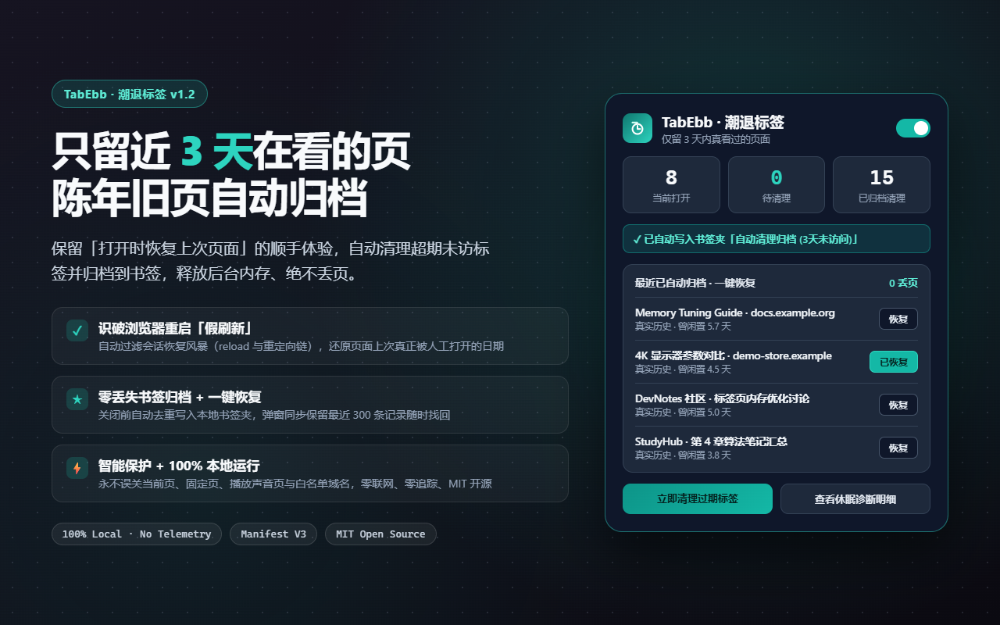
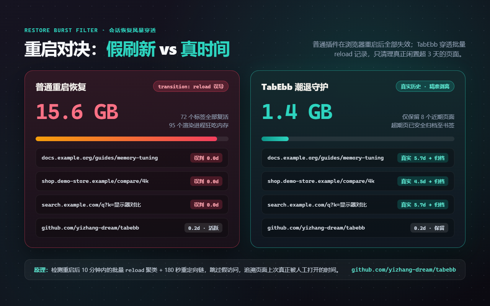

# TabEbb · 潮退标签

> 保留「启动时自动打开上次页面」的顺手体验，自动清理超过 **3 天** 未真正访问过的陈年标签并归档到书签，释放后台渲染进程内存，绝不丢页。
>
> *Keep "Continue where you left off" without tab bankruptcy — TabEbb detects and strips fake browser session-restore reloads, auto-closes tabs untouched for 3+ days, and archives them safely to bookmarks.*

<p align="center">
  
</p>
<p align="center">
  
</p>

---

## 为什么做 TabEbb？ / Why TabEbb?

浏览器重启恢复上次会话时，有两个很隐蔽的坑：
1. 它会把几十个陈年标签的 `tab.lastAccessed` 统统重置成**刚启动的时间**；
2. 它还会给恢复出来的老标签批量写一条 `transition: "reload"` 的历史记录（某些搜索页/单页应用随后还会再触发一次 `link` 跳转）。

结果普通的“按标签时间自动关标签”插件在重启后全都会失效——以为 5 天、2 周前打开的页面“刚刚才看过”。

**TabEbb 的核心解法：**
- **双真源时间识别**：
  - 扩展运行期间，实时记录你**真正点击激活**过哪些标签（`source: activated`），重启浏览器也不会丢失；
  - 对重启恢复出来的历史老标签，直接查询本地 `chrome.history.getVisits`，**自动识别并剥离批量会话恢复风暴（`reload` 聚类窗口 + 180 秒内紧跟的重定向链）**，还原页面上一次真正被人工访问的日期；
  - 对处于休眠态且已超出浏览器 90 天历史库的老标签，也能精准识别并清理。
- **零丢失兜底**：关闭前自动写入本地书签夹 `自动清理归档 (3天未访问)`（按 URL 自动去重），弹窗内同步保留最近 300 条关闭记录，支持一键恢复。
- **多重保护**：永不关闭当前活跃标签、固定标签（Pinned）、正在发声标签、窗口内最后一个标签、内置页面及自定义域名白名单。
- **100% 本地运行**：零网络请求、零追踪、零广告，MIT 开源（见 [PRIVACY.md](PRIVACY.md)）。

---

## 安装 / Installation

### 方式一：Microsoft Edge Add-ons 商店（上架审核准备就绪）
见 [EDGE_STORE_LISTING.md](EDGE_STORE_LISTING.md) 与发布包脚本 `node scripts/package.mjs`。

### 方式二：开发者模式加载源码（Edge / Chrome 通用）
1. 克隆本仓库：`git clone https://github.com/yizhang-dream/tabebb.git`
2. 浏览器打开 `edge://extensions`（或 `chrome://extensions`）
3. 开启 **开发人员模式（Developer mode）**
4. 点击 **加载解压缩的扩展（Load unpacked）**，选择本仓库的 `extension/` 目录即可。

---

## 本地开发与测试 / Development

```bash
# 运行核心判定与会话恢复风暴过滤单元测试
node tests/test-core.mjs

# 打出干净的商店提交安装包 dist/tabebb-v1.2.0.zip
node scripts/package.mjs
```

---

## 目录结构

- `extension/` — Manifest V3 扩展本体（支持中英双语 `_locales`）
- `tests/` — 核心算法单元测试（覆盖重启 `reload` 风暴与重定向链过滤）
- `scripts/` — 商店纯净打包脚本
- `store-assets/` — 商店宣传截图与磁贴
- `PRIVACY.md` — 公开隐私政策
- `EDGE_STORE_LISTING.md` — Microsoft Edge Add-ons 商店上架完整表单材料

## License

[MIT](LICENSE)
